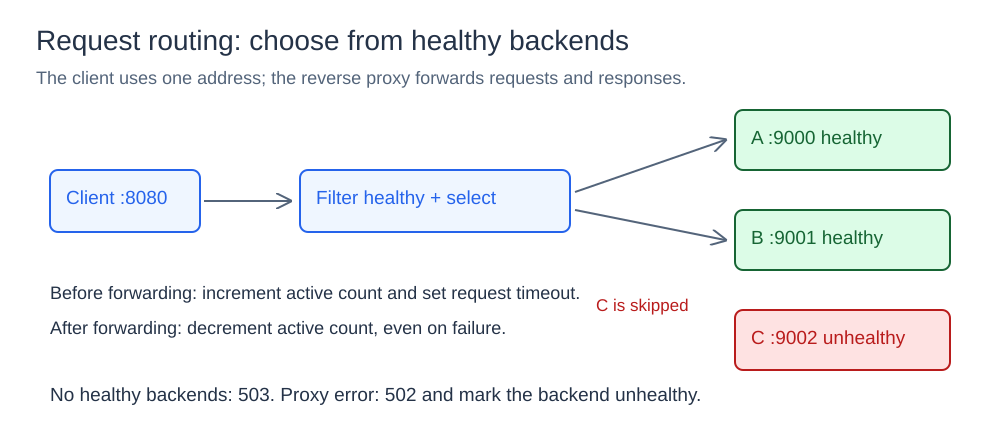
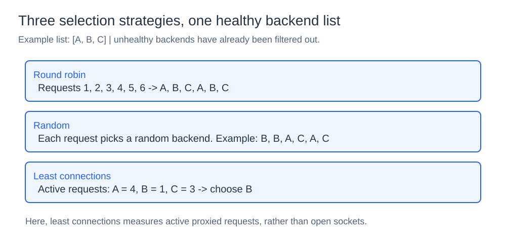
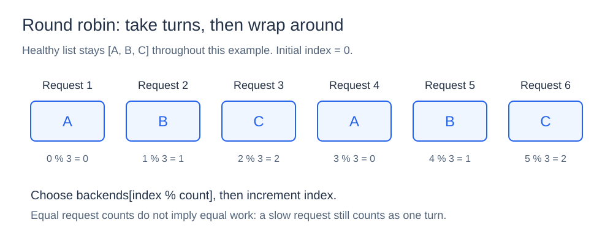
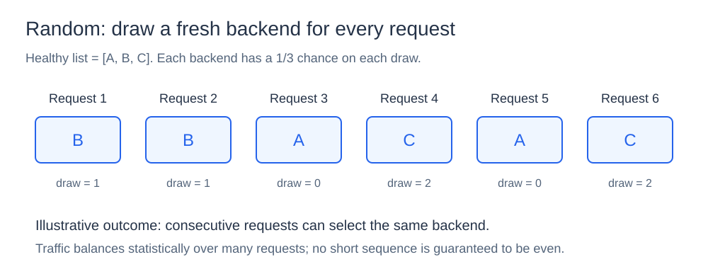
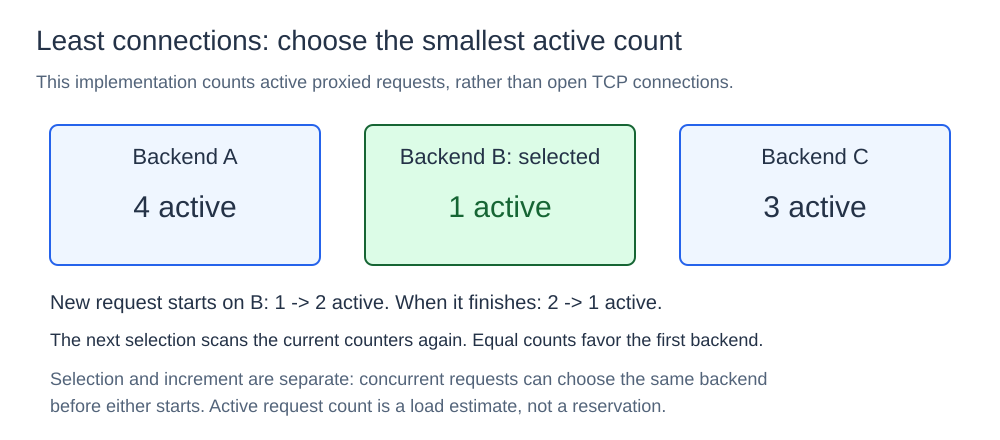
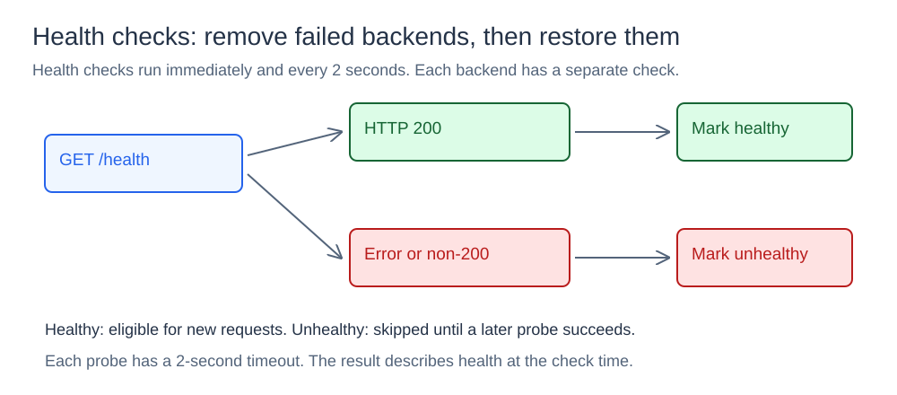

# Load Balancer

## What it is

A load balancer receives client requests at one address. It selects a backend server for each request. An HTTP reverse proxy sends the request to that server and returns the response.



## How it works

The load balancer selects from the healthy backends. It supports round-robin, random, and least-connections selection. It also provides health checks, request timeouts, and shutdown control.

### Request lifecycle

The load balancer makes a list of healthy backends. It selects one backend and increases its active-request count. It sets the request timeout before it calls `httputil.ReverseProxy`.

After the proxy returns, the load balancer decreases the active-request count. A proxy error marks the backend unhealthy and returns status `502`. If no backend is healthy, the load balancer returns status `503`.

### Selection algorithms

Each selector implements this interface:

```go
type Selector interface {
    Next([]*servers.Server) *servers.Server
}
```



All three algorithms receive the list of healthy backends. If this list is empty, the selector returns `nil`. The load balancer then returns status `503`.

#### Round robin

Round robin selects each backend in list order. It selects `backends[index % len(backends)]`, then increases the index. The modulo operation returns selection to the start of the list.



For a fixed list `[A, B, C]`, the selection order is `A, B, C, A, B, C`. A mutex protects the index during concurrent calls. If backend health changes, the selector uses the current index with the new healthy list. Thus, the selection order can change.

Selection takes O(1) time. Round robin gives backends equal request counts for a fixed list. It does not measure the work that each request requires. A backend with slow requests can receive more work before those requests finish.

Use `-algorithm roundrobin`.

#### Random

Random selection gets an index from `rng.Intn(len(backends))`. It selects the backend at that index. With three healthy backends, each backend has a one-third probability of selection for each request.



One possible selection order is `B, B, A, C, A, C`. Each request makes a new selection. A mutex protects the random-number generator during concurrent calls.

Selection takes O(1) time. A large number of requests usually gives a more equal distribution. A short series of requests can select one backend many times. The algorithm does not measure backend load.

Use `-algorithm random`.

#### Least connections

Least connections selects the backend with the smallest active-request count. This implementation counts requests that the proxy currently processes. It does not count open TCP connections.



If A has four active requests, B has one, and C has three, the selector chooses B. `StartRequest` increases B's count to two before the proxy starts. The deferred `FinishRequest` decreases this count after the proxy returns, including after an error. The next selection reads the counts again.

If counts are equal, the selector chooses the first backend in the healthy list. A mutex protects the selector. Atomic operations protect each active-request count. Selection and the count increase are separate operations. Concurrent requests can select the same backend before either request increases its count.

Selection takes O(n) time for n healthy backends. A slow request keeps its backend's count high until the request finishes. The count does not measure CPU use, memory use, or backend capacity.

Use `-algorithm leastconnections`.

### Health checks and recovery



The command starts a health check immediately. It repeats the check every two seconds. Each backend has a separate check goroutine and a two-second HTTP client timeout.

A `GET /health` response with status `200` marks the backend healthy. An error or a different status marks it unhealthy. A later successful check makes the backend available for selection again.

## State, concurrency, and failures

Each backend stores its URL, reverse proxy, health flag, and active-request count. A `sync.RWMutex` protects the health flag. An `atomic.Int64` stores the count.

The HTTP server processes requests concurrently. A context stops new health checks during shutdown. The command responds to interrupt and termination signals. It gives the HTTP server up to five seconds to stop.

A backend can fail after selection. A health check only shows the backend's condition at the time of the check. The request timeout limits the time that a request can wait. The load balancer runs in one process, which can also fail.

## Project structure

```text
algorithms/        backend selection algorithms
loadbalancer/      routing, proxying, and health checks
servers/           backend state and reverse proxy
cmd/server/        local backend server
cmd/loadbalancer/  load balancer process
go.mod
```

## Run it

Open a terminal in the `01-load-balancer` directory.
Run each backend command in a separate terminal:

```powershell
$env:PORT="9000"; $env:SERVER_ID="server-1"; go run ./cmd/server
$env:PORT="9001"; $env:SERVER_ID="server-2"; go run ./cmd/server
$env:PORT="9002"; $env:SERVER_ID="server-3"; go run ./cmd/server
```

Start the load balancer:

```powershell
go run ./cmd/loadbalancer -algorithm roundrobin -backends http://localhost:9000,http://localhost:9001,http://localhost:9002
```

Send a request:

```powershell
(Invoke-WebRequest http://localhost:8080/test -UseBasicParsing).Content
```

Stop one backend.
Send more requests.
After a failed health check, the load balancer selects from the remaining healthy backends.
