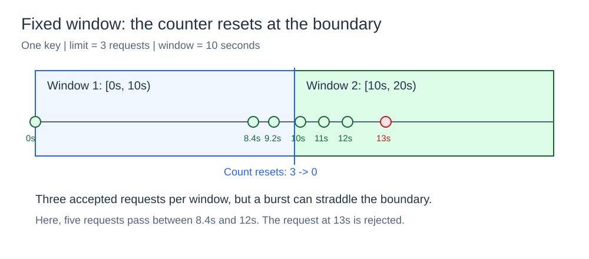
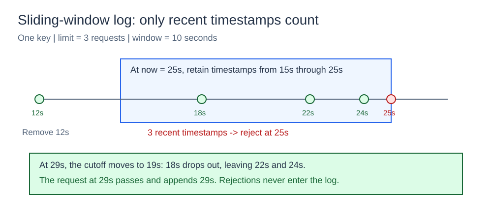
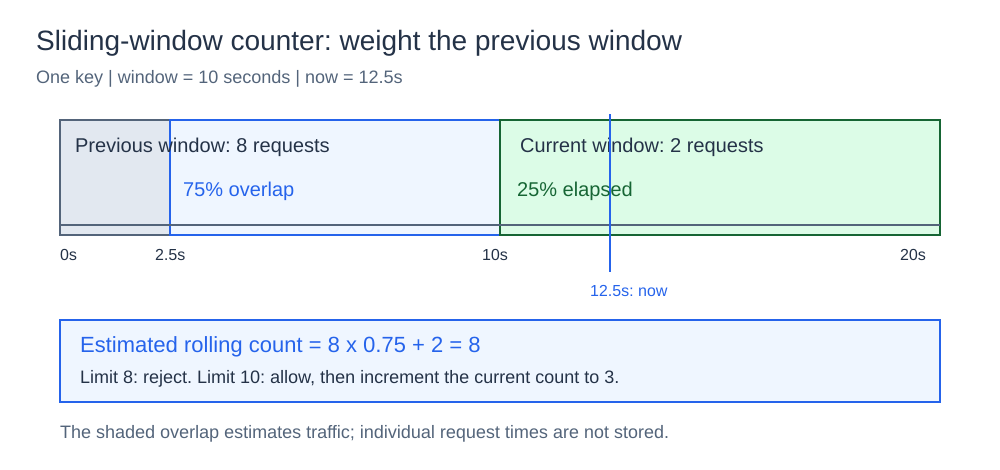
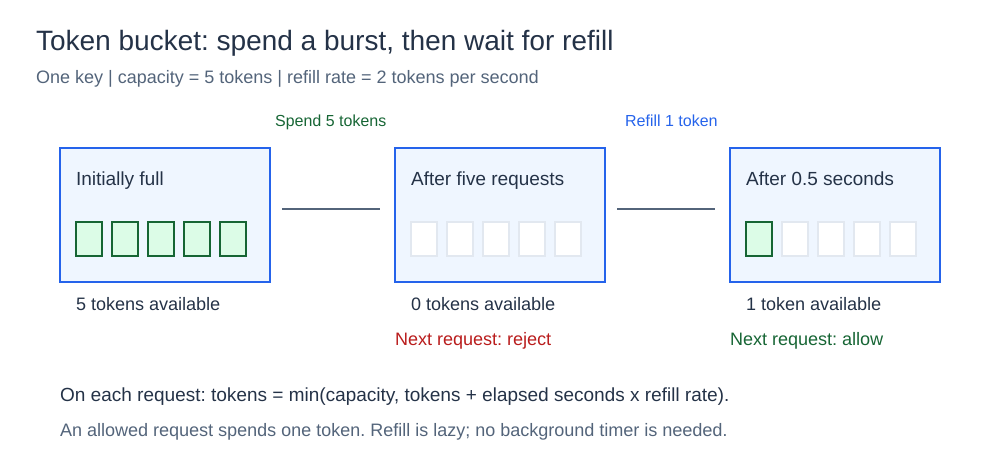

# Rate Limiter

## What it is

A rate limiter controls how many requests a client can send. It accepts or rejects each request before the service does the work.

## How it works

Each key has separate state. A key can identify a client, user, API token, or resource. All four algorithms provide an `Allow(key)` decision.

Each algorithm checks and changes its state under one mutex. This prevents concurrent requests from using the same old count. The diagrams show one key at a time.

## The four algorithms

### Fixed window

The fixed-window algorithm stores a start time and count for each key. The first request starts a window. The count resets when that window expires.



With a limit of three, the first three requests in a window pass. The limiter rejects later requests until the window expires. A client can use one allowance just before expiration and another just after expiration. Thus, many requests can pass near the boundary.

### Sliding-window log

The sliding-window log stores the times of accepted requests. For each new request, it removes times before `now - window`. It compares the number of remaining times with the limit.



At time 25 seconds, a 10-second window removes times before 15 seconds. A time exactly at 15 seconds remains. Rejected requests do not add times to the log. The algorithm gives an exact count for this interval, but requires memory for individual request times.

### Sliding-window counter

The sliding-window counter stores the counts for the previous and current windows. It calculates the part of the previous window that overlaps the sliding interval. It uses that proportion to estimate the number of recent requests.



At 25 percent through the current window, the previous window has a weight of 75 percent. If the previous count is eight and the current count is two, the estimate is `8 * 0.75 + 2 = 8`. The algorithm stores two counts instead of individual request times. This reduces memory use, but the count is an estimate.

### Token bucket

The token bucket stores a token count and the last refill time. Each accepted request uses one token. Elapsed time adds tokens up to the bucket capacity.



A bucket with capacity five can accept five immediate requests. At two tokens per second, an empty bucket gets one token after half a second. The limiter calculates refill when a request arrives. It does not use a background timer.

Capacity controls the size of an immediate request burst. The refill rate controls the average request rate over time.

## Concurrency

Each limiter protects its map and state changes with a mutex. State exists in one process. Different processes do not share request limits.

## Project structure

```text
algorithms/       rate-limiting algorithms
ratelimiter/      shared limiter interface
cmd/fixedwindow/  runnable demonstrations
go.mod
```

## Run it

Open a terminal in the `02-rate-limiter` directory.
Run these commands:

```powershell
go run ./cmd/fixedwindow -algorithm fixed -limit 3 -window 5s -requests 5
go run ./cmd/fixedwindow -algorithm sliding -limit 3 -window 5s -requests 5
go run ./cmd/fixedwindow -algorithm sliding-counter -limit 3 -window 5s -requests 5
go run ./cmd/fixedwindow -algorithm token -capacity 3 -refill-rate 1 -requests 5
```

The commands demonstrate fixed windows, a sliding log, a sliding counter, and token refill.
