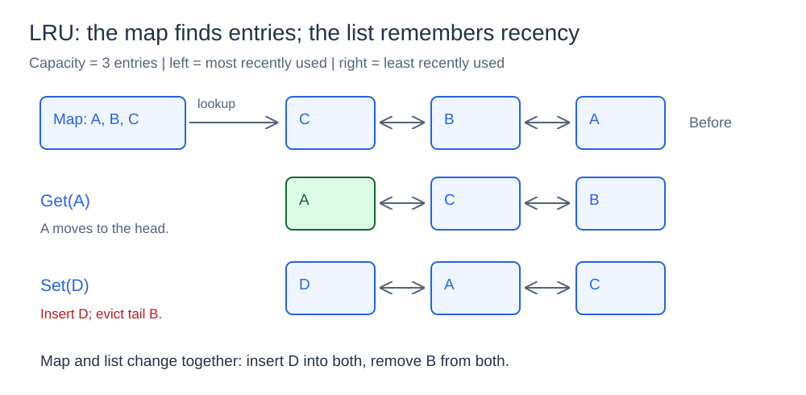
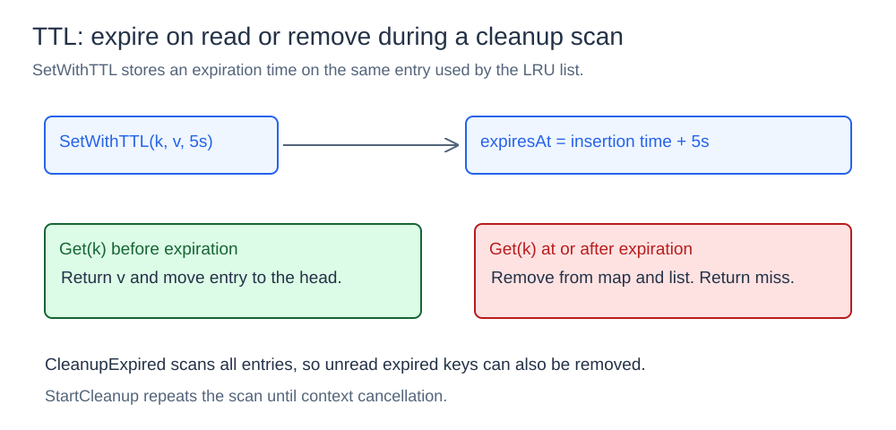

# LRU Cache

## What it is

A cache keeps values in memory for repeated access. This cache has a fixed entry capacity. When it exceeds that capacity, it removes the least recently used (LRU) entry.

## How it works

A map finds entries by key. A custom doubly linked list records the order of recent use. The cache also supports a time to live (TTL), explicit deletion, and background expiration checks.

### Map, list, and eviction



The map points to list entries. The head contains the most recently used entry. The tail contains the least recently used entry. A map lookup takes O(1) time on average. The `prev` and `next` pointers permit O(1) movement and removal.

`Set` inserts or changes an entry at the head. `Get` also moves a valid entry to the head. If insertion exceeds capacity, the cache removes the tail from the list and map. `Delete` removes the specified entry from both structures.

The implementation uses a custom list instead of `container/list`. This makes the list operations visible in the source code.

### TTL expiration and cleanup



`SetWithTTL` stores an expiration time. If `Get` finds an expired entry, it removes the entry and returns a cache miss. `CleanupExpired` checks all entries and removes expired entries. Thus, it can remove expired entries that no client reads.

`StartCleanup` repeats this check on a ticker. It stops when its context is canceled. Plain `Set` stores a value without an expiration time.

`Len` and `Keys` can include expired entries until a read or cleanup removes them. `Keys` returns keys in order from most recent use to least recent use.

## Concurrency and cost

One mutex protects the map, list links, values, expiration times, and entry count. The mutex keeps related changes together. `Get` uses an exclusive lock because it changes list order and can remove expired entries.

| Operation | Time complexity |
| --- | --- |
| `Get`, `Set`, `SetWithTTL`, `Delete`, eviction | O(1) |
| `Len` | O(1) |
| `Keys`, `CleanupExpired` | O(n) |

## Project structure

```text
cache/       map, linked list, TTL, and cleanup
cmd/basic/   cache demonstration
go.mod
```

## Run it

Open a terminal in the `03-lru-cache` directory.
Run this command:

```powershell
go run ./cmd/basic
```

The demonstration shows recency changes, eviction, TTL expiration, concurrent access, and background cleanup.
