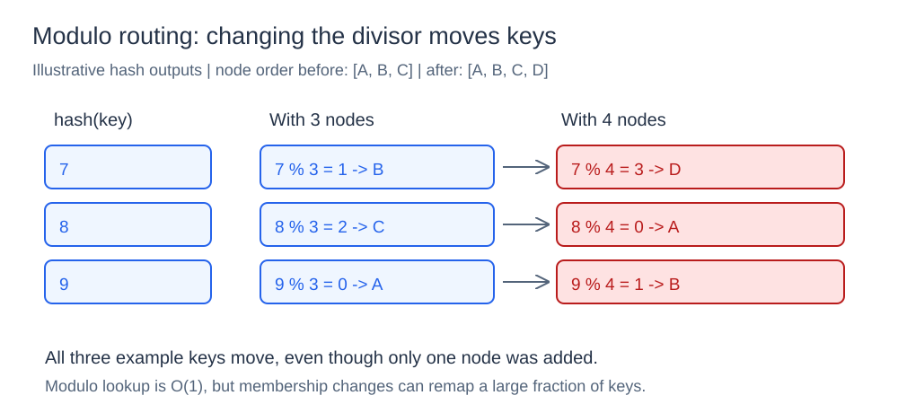
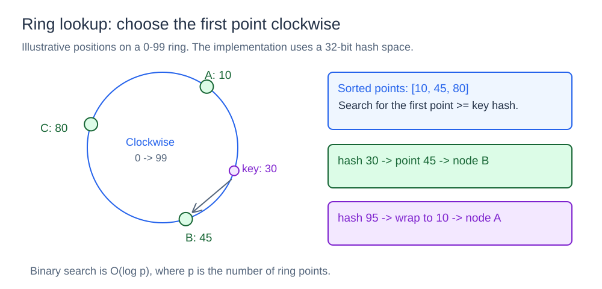
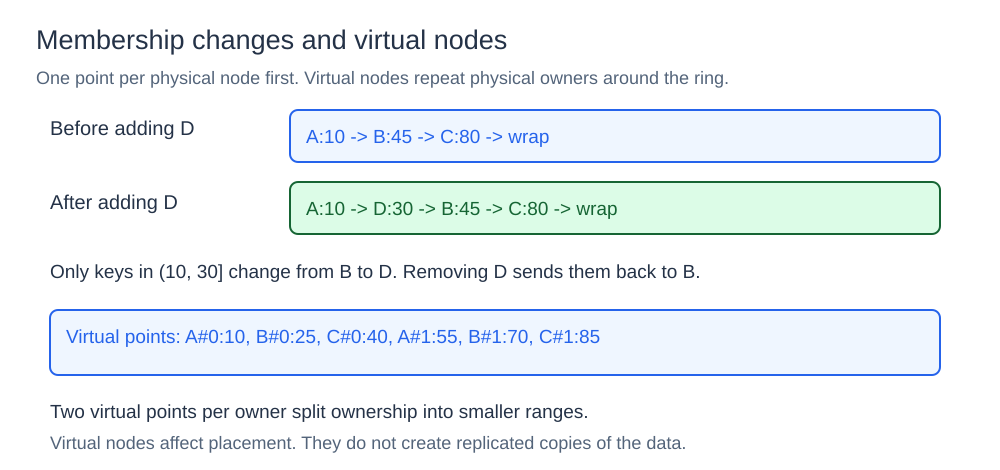

# Consistent Hashing

## What it is

Let's say you have several cache or storage servers and need to decide where each key should go. Consistent hashing maps a key to a node while reducing movement when nodes are added or removed.

## How it works

The component includes two placement algorithms: a modulo baseline and a consistent-hash ring. Both map a key to a physical node; neither stores the key's value. Diagram positions and hash outputs below are illustrative.

### Modulo baseline

`NewModulo(nodes)` copies the ordered node list. `Lookup(key)` hashes the key with FNV-1a and chooses `nodes[hash(key) % len(nodes)]`. An empty list returns an empty string.



For a hash output of 7, three nodes select index `7 % 3 = 1`, or B. Adding D changes the divisor to four, selecting index `7 % 4 = 3`, or D. Many keys can change owner even though only one node was added.

Lookup is O(1), and the metadata is small. The trade-off is disruptive remapping when the node list changes. This baseline has a fixed list; comparing membership configurations requires constructing separate routers.

### Ring lookup

The ring keeps a sorted slice of hash points, a map from each point to its physical owner, and the points belonging to each node. Keys and virtual-node names are hashed using the first 32 bits of SHA-1. The modulo baseline uses a different hash function, so its numeric outputs should not be compared directly with ring hashes.



`Lookup(key)` binary-searches for the first point greater than or equal to the key's hash. If the search passes the final point, it wraps to the first. With points `A:10`, `B:45`, and `C:80`, hash 30 selects B; hash 95 wraps to A. An empty ring returns an empty string.

Lookup is deterministic for a fixed ring and takes O(log p), where p is the total number of ring points.

### Adding and removing nodes



Adding D at position 30 changes ownership only for hashes in `(10, 30]`: those keys previously went to B at 45 and now go to D. Removing D returns that interval to B. With several points per physical node, the same rule applies to each point's preceding interval.

`AddNode` ignores a node already present, creates its points, and sorts the ring. If a point collides with an existing point, it advances until it finds an unused position. `RemoveNode` removes all points owned by that node; an unknown node is ignored.

These operations update placement metadata. Applications must move stored values separately when ownership changes.

### Virtual nodes

`New(100)` creates 100 virtual points per physical node. Names such as `node-a#0` and `node-a#1` hash to different positions, but both resolve to `node-a`. Calling `New()` uses one point per node.

Multiple points divide a physical node's ownership into smaller ranges, usually improving distribution and spreading the effect of membership changes. They also increase metadata and sorting work. Virtual nodes do not replicate values or guarantee perfectly equal load; popular keys can still create hot spots.

```go
placement := ring.New(100)
placement.AddNode("node-a")
placement.AddNode("node-b")
owner := placement.Lookup("user:42")
```

## State, concurrency, and limits

Ring metadata uses O(p) space. The demos build rings before looking up keys. The ring has no mutex: adding or removing nodes concurrently with lookups requires external synchronization or immutable snapshots.

Replication, data migration, health checking, and consistency are separate mechanisms. A placement decision alone does not prove that its owner is reachable or has the requested value.

## Project structure

```text
ring/       modulo router and consistent-hash ring
cmd/demo/   key redistribution demonstration
diagrams/   SVG illustrations
go.mod
```

## Run it

Run from the `04-consistent-hashing` directory:

```powershell
go run ./cmd/demo
```

The demo uses 100 virtual points per node. It compares routes for 100 keys before and after adding node-d, then before and after removing node-b, printing sample routes and counts of keys that changed owner. It compares routing metadata; it does not migrate stored values.
