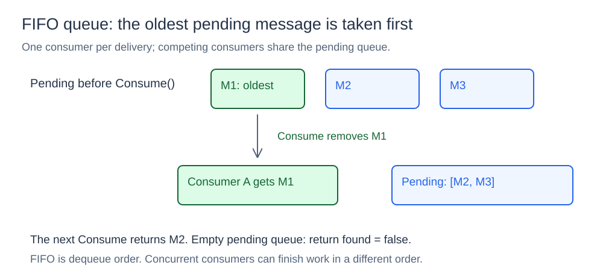
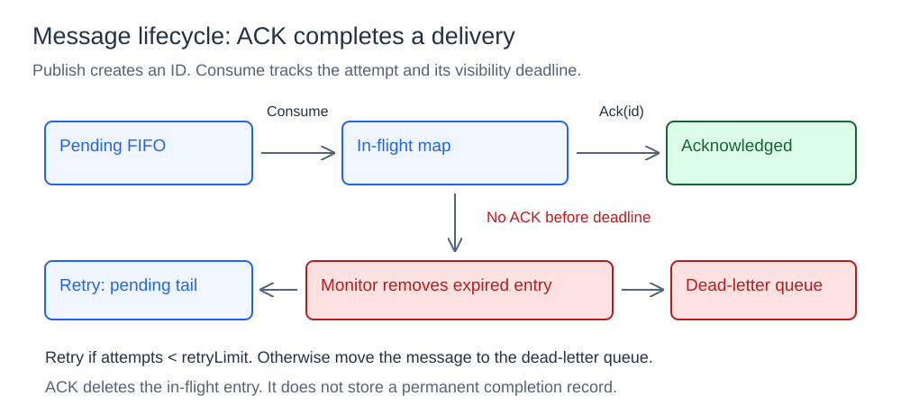
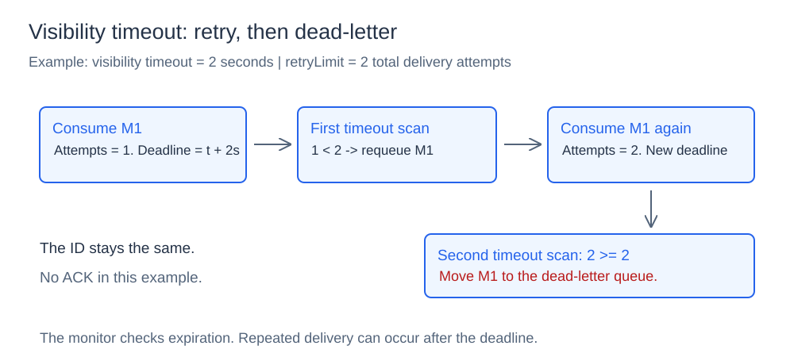

# Message Queue

## What it is

A message queue stores work until a consumer can process it. Producers and consumers can operate at different rates.

## How it works

The broker has a pending queue, an in-flight map, and a dead-letter queue. The queues use first in, first out (FIFO) order. Each message has an ID, body, and attempt count. Each delivery goes to one consumer at a time.

### FIFO delivery



`Publish(body)` creates a message ID and sets the attempt count to zero. It then adds the message to the pending tail. `Consume()` removes the oldest pending message. If the queue is empty, it returns `false` without a wait.

For `[M1, M2, M3]`, consecutive calls remove M1 and M2. Concurrent consumers can finish in a different order. Concurrent producers can insert messages in a different order from ID allocation. Thus, message IDs do not specify FIFO order.

A mutex protects each queue's slice. Insertion adds a message at the tail. Removal clears the first slot and advances the slice. Insertion takes amortized O(1) time. Removal takes O(1) time.

### In-flight messages and acknowledgements



When a consumer receives a message, the broker increases its attempt count. It records `deadline = now + visibilityTimeout` in the in-flight map. The message is no longer pending. Another consumer cannot take it until the broker returns it to pending.

After successful work, the consumer sends an acknowledgment (ACK) with `Ack(id)`. If the ID is in flight, the function removes it and returns `true`. Otherwise, it returns `false`. The broker does not keep a permanent record of completed messages.

### Visibility timeout, retries, and dead letters



`RequeueExpired()` removes deliveries that reached their deadlines. If `Attempts < retryLimit`, it adds the message to the pending tail. Otherwise, it adds the message to the dead-letter queue. The ID and body stay the same.

Here, `retryLimit = 2` permits two total attempts. This includes the first attempt and one repeated delivery. If neither attempt receives an ACK, the second expiration moves the message to the dead-letter queue. `ConsumeDeadLetter()` reads and removes a message from that queue.

`StartVisibilityMonitor(ctx, interval)` checks expiration on a ticker until the context is canceled. The check can occur after the exact deadline. Without this monitor or explicit `RequeueExpired` calls, expired messages stay in flight.

### Delivery guarantees

A message without an ACK can return to a consumer. For example, a consumer can finish work and fail before its ACK reaches the broker. Use idempotent operations when repeated work can cause incorrect results. An idempotent operation gives the same result if the consumer repeats it.

An ACK identifies a message, not a delivery attempt. A late ACK can remove a newer delivery of the same message. This model permits repeated delivery and limits the number of attempts. It does not provide exactly-once processing.

## Concurrency and limits

The broker mutex protects IDs and the in-flight map. Each queue has a separate mutex. Transfers between queues and the map use separate lock operations. These transfers do not form one transaction. Length methods do not return one atomic view of all three states.

Expiration checks take O(i) time for i in-flight messages. The queues have no capacity limit. All state exists in one process. A restart loses all messages. The broker does not join consumer work and an ACK in one transaction.

## Project structure

```text
message/           message identity and payload
queue/             FIFO storage
broker/            publishing, consuming, ACKs, and retries
cmd/fifo/          ordering demonstration
cmd/ack/           failure and retry demonstration
cmd/concurrent/    concurrent producers and consumers
diagrams/          SVG illustrations
go.mod
```

## Run it

Open a terminal in the `05-message-queue` directory.
Run these commands:

```powershell
go run ./cmd/fifo
go run ./cmd/ack
go run ./cmd/concurrent
```

The demonstrations show FIFO order, ACKs, repeated delivery, dead-letter messages, and concurrent processing.
