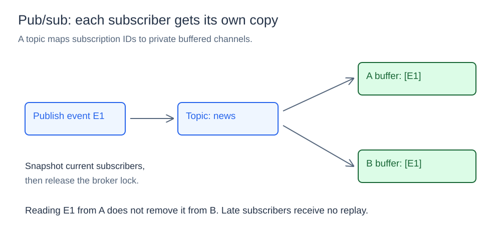
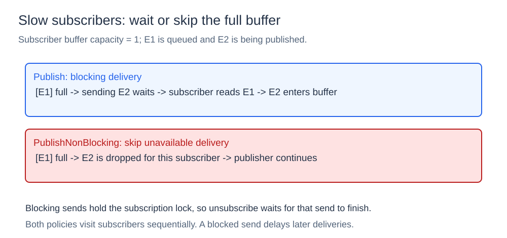
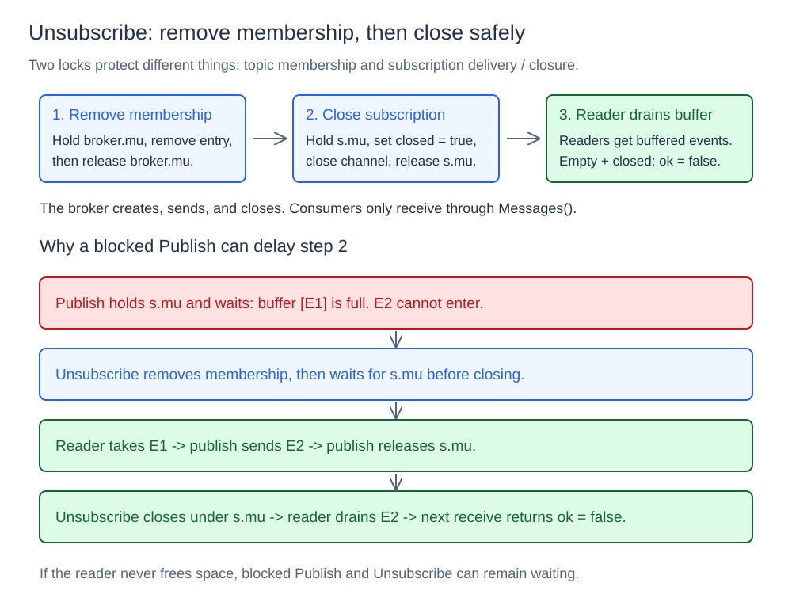

# Pub/Sub Broker

## What it is

A publish/subscribe (pub/sub) broker sends each event to the subscribers of a topic. Each subscriber receives a separate copy. Subscribers do not share one work queue.

## How it works

The broker maps topics to subscription IDs. Each subscription has its own buffered channel. The channel holds events until the consumer reads them.

### Subscribe and fan out



`Subscribe(topic, buffer)` creates an ID and channel. It adds the subscription to the topic. If the buffer size is less than one, the broker uses one. Consumers read the receive-only channel from `Messages()`.

`Publish(topic, event)` copies the current subscriber list under the broker's read lock. It releases that lock before it sends events. It then visits each subscription and sends a copy.

A read from A does not remove the copy in B. An empty topic receives no deliveries. A subscriber that joins later does not receive previous events.

```go
news := broker.New()
reader := news.Subscribe("news", 4)
news.Publish("news", broker.Event{ID: "event-1", Body: "hello"})
event := <-reader.Messages()
```

### Slow-subscriber policies



For a one-event buffer, E1 fills the channel until a consumer reads it. If E2 arrives first, the method determines the result:

| Method | Full buffer | Result |
| --- | --- | --- |
| `Publish` | Wait for space | Return the successful delivery count |
| `PublishNonBlocking` | Skip this subscription | Return delivered and dropped counts |

`Publish` waits to send to an open subscription. A slow consumer delays the publisher. It also delays later subscriptions in the same loop. The map does not specify subscription order.

`PublishNonBlocking` uses a channel `select` with a `default` branch. If the buffer is full, it skips the event for that subscription. It also counts a subscription closed after the list copy as a dropped delivery.

Both methods acquire subscription mutexes. Thus, nonblocking describes the buffer-capacity decision. It does not mean that mutex operations cannot wait.

### Unsubscribe and channel ownership



The broker creates, sends to, and closes the channel. Consumers only read the receive-only channel from `Messages()`. Closure stops future sends but keeps events already in the buffer.

`Unsubscribe(subscription)` removes membership under the broker lock. If the topic has no subscriptions, it removes the topic too. It then acquires the subscription mutex and closes the channel. A repeated unsubscribe call returns `false`.

The subscription mutex prevents a send on a closed channel. A blocking send holds that mutex until the send finishes. Unsubscribe must wait for the mutex. It cannot cancel that send. A publisher with an earlier copy of the subscriber list can still attempt delivery during unsubscribe.

In the diagram, E1 fills a one-event buffer. The publisher holds the subscription mutex while it waits to send E2. Unsubscribe removes membership, then waits for that mutex.

The consumer reads E1 and frees space. The publisher sends E2 and releases the mutex. Unsubscribe can then close the channel. The consumer can read E2 after closure. The next read from the empty channel returns `ok == false`.

A `for event := range subscription.Messages()` loop reads buffered events until the closed channel is empty. The loop then ends. If the consumer never frees space, the blocked publisher and unsubscribe call can continue to wait.

## Concurrency, cost, and limits

The broker's `sync.RWMutex` protects topic membership. Each subscription mutex protects sends and closure. The broker releases its lock before sends. Thus, a full channel does not hold the membership lock for other topics.

Fan-out visits s subscribers in O(s) work, plus time for locks and buffer space. Concurrent publishers can give different subscribers different event orders. There is no global order across publishers.

The broker keeps all state in one process. It does not provide persistence, historical replay, acknowledgments, retries, or durable delivery.

## Project structure

```text
broker/             topics, subscriptions, and delivery
cmd/demo/           fan-out and unsubscribe demonstration
cmd/concurrent/     concurrent publisher demonstration
diagrams/           SVG illustrations
go.mod
```

## Run it

Open a terminal in the `06-pub-sub-broker` directory.
Run these commands:

```powershell
go run ./cmd/demo
go run ./cmd/concurrent
```

The demonstrations show event copies, unsubscribe, and concurrent publication. They also show how a full buffer causes a nonblocking send to skip an event.
