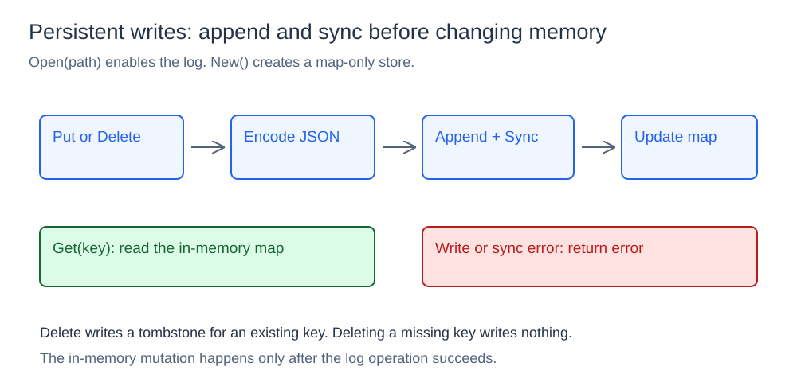
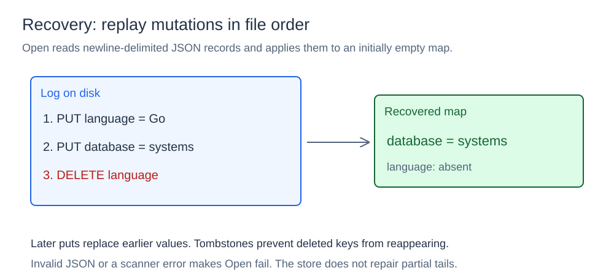
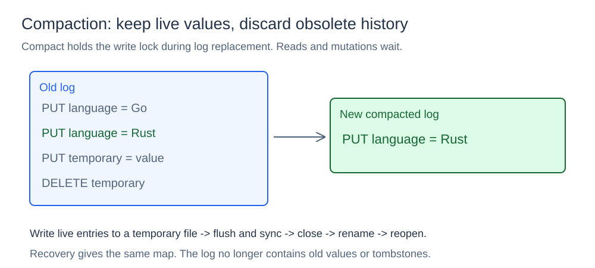

# Key-Value Store

## What it is

Let's say your application needs to store and retrieve data using a name. A key-value store maps a string key to a string value.

```text
key:   language
value: Go
```

## How it works

`New()` creates an in-memory store. `Open(path)` adds an append-only JSON log and replays it to recover previous values. Reads use the in-memory map in either mode.

### Writes and tombstones



For a persistent store, `Put(key, value)` marshals a record, appends a newline, writes it, and calls `file.Sync`. Only after that succeeds does it update the map. A write or sync error is returned before the in-memory mutation is applied.

`Delete(key)` follows the same order, appending a tombstone before removing an existing key. A missing key returns `false` without writing a record. `Get(key)` reads only the map and reports whether the key exists.

```json
{"operation":"put","key":"language","value":"Go"}
{"operation":"delete","key":"language"}
```

Appending mutations avoids rewriting the full database on every update, but old values and tombstones accumulate until compaction. Map access is O(1) on average; persistent mutations also pay serialization, file-write, and sync costs.

### Recovery by replay



`Open(path)` creates or opens the file, scans its newline-delimited JSON records, and applies them in order to an empty map. A later put replaces an earlier value for the same key. A delete removes the key so an earlier put cannot resurrect it during replay.

For `PUT language=Go`, `PUT database=systems`, then `DELETE language`, recovery leaves only `database=systems`. The recovered file remains open for future appends. Replay time grows with the log's size, including obsolete history.

Malformed JSON or a scanner error makes startup fail. This component does not repair a partial final record or verify record checksums; the separate write-ahead-log component explores those mechanisms.

### Log compaction



`Compact()` snapshots the live values while holding the store's write lock, sorts the keys, and writes one put record per key to a temporary file in the same directory. It flushes the buffer, syncs and closes the temporary file, closes the old log, renames the temporary file over it, then reopens the log for appending.

If language was updated from Go to Rust and a temporary key was created then deleted, the compacted log needs only `PUT language=Rust`. Older puts and tombstones disappear, while replay produces the same live map. Compacting a map-only store does nothing.

Sorting k live keys takes O(k log k), plus the cost of writing their values. Compaction reduces disk usage and future replay work, but blocks reads and mutations during the rewrite. It is a local file-replacement mechanism, rather than a transactional crash-recovery protocol.

## Concurrency and limits

One `sync.RWMutex` protects the map and file operations. Reads use `RLock`; mutations, compaction, and close take the write lock. This prevents an ordinary write from interleaving with log replacement. `Close()` syncs and closes an open file.

All live values must fit in memory. The store uses local files and one process; it does not provide replication, transactions, or cross-process coordination.

## Project structure

```text
store/             map, log records, replay, and compaction
cmd/basic/          CRUD demonstration
cmd/concurrent/     concurrent access demonstration
cmd/persistent/     persistence and recovery demonstration
diagrams/           SVG illustrations
go.mod
```

## Run it

Run from the `07-key-value-store` directory:

```powershell
go run .\cmd\basic\main.go
go run .\cmd\concurrent\main.go
go run .\cmd\persistent\main.go
```

The persistent demo writes records, reopens the log, rebuilds the map, and compacts obsolete history.
