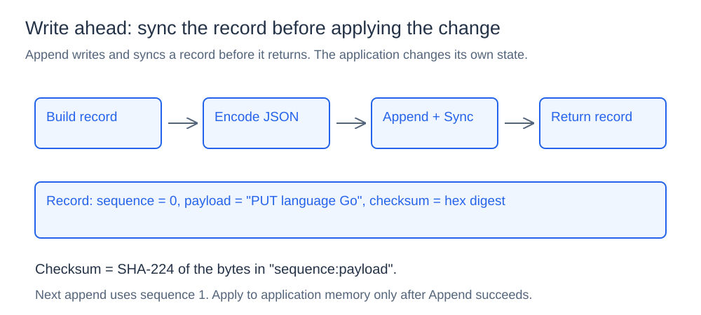
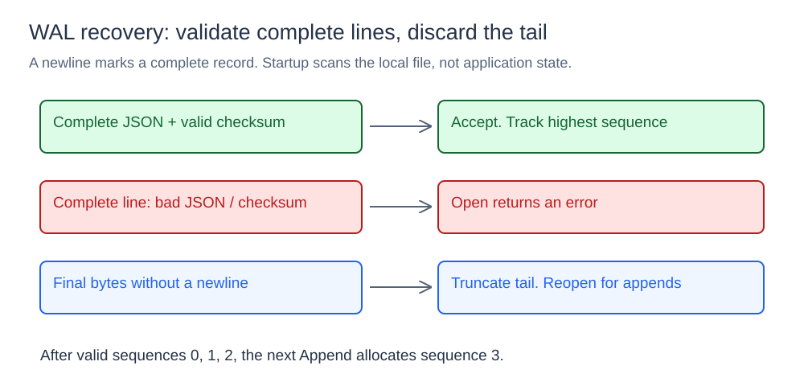

# Write-Ahead Log

## What it is

A write-ahead log records a mutation before the application applies it to memory. The durable record gives the application a history it can use to rebuild state after a crash.

## How it works

### Append and sync



`Open(path)` creates or opens an append-only file. `Append(payload)` allocates the next sequence, builds a record containing the sequence, payload, and checksum, encodes it as JSON with a trailing newline, then writes and syncs the file. It advances the sequence only after those operations succeed.

An empty log starts at sequence zero. Each successful append increments the sequence. The payload is an opaque string: the WAL does not interpret application operations such as `set language Go`.

The application should apply its mutation only after `Append` succeeds. This component returns the record but does not apply it to an application state machine.

### Checksum validation

The checksum is the hexadecimal SHA-224 digest of `sequence:payload`. The implementation calls `sha256.Sum224`; despite the package name, the digest is SHA-224. Including the sequence detects edits to either the sequence or payload when the stored checksum is unchanged.

During startup, `Open` decodes each complete record and recomputes its checksum. Invalid JSON or a checksum mismatch returns an error. Checksums detect record corruption; they do not authenticate records against an attacker who can rewrite both record and checksum.

### Incomplete-tail recovery



Newlines define complete records. If the final bytes have no terminating newline, `Open` treats them as an incomplete tail, truncates those bytes, and reopens the file for appending. This rule also discards otherwise valid JSON at the end if its newline is missing.

After validating complete records, startup sets the next sequence to one greater than the highest sequence found. For records 0, 1, and 2, the next append uses 3. Startup does not enforce contiguous or strictly increasing historical sequences.

`Open` scans and validates history but does not expose a replay iterator or return recovered application state. An application using this mechanism still needs to decode and apply its own payload history.

## Concurrency, cost, and limits

One mutex protects appends, sequence allocation, sync, and close. Concurrent append calls are serialized. `Close` syncs and closes the file.

Append cost includes payload encoding, writing, and a filesystem sync. Startup reads the entire file into memory, so recovery time and temporary memory grow with log size. There is no log segmentation, compaction, replication, or consensus in this component.

## Project structure

```text
wal/wal.go        record format, append, validation, and tail recovery
cmd/demo/main.go  append and sequence demonstration
diagrams/         SVG illustrations
go.mod
```

## Run it

Run from the `08-write-ahead-log` directory:

```powershell
go run ./cmd/demo
Get-Content ./wal.log
```

The demo appends three payloads and prints their sequences. Running it again continues from the existing log. Corruption rejection and tail recovery happen on `Open`; the demo does not inject those failures automatically. Use a disposable copy of the log when experimenting with edits or truncated records.
