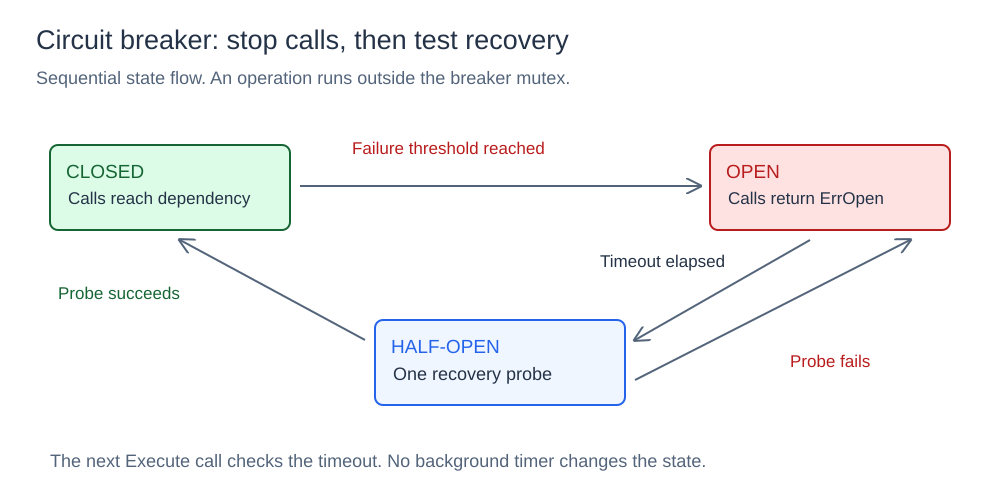
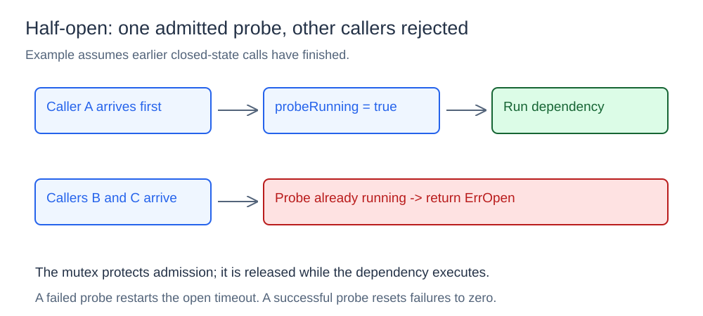

# Circuit Breaker

## What it is

A circuit breaker controls calls to a dependency. After repeated failures, it stops new calls for a specified interval. This prevents additional work on calls that are likely to fail.

## How it works

### Closed, open, and half-open states



`New(threshold, resetTimeout)` starts in `closed`. `Execute(operation)` checks whether a call can proceed. If it accepts the call, it runs the function and records the result.

| State | Call behavior | State change |
| --- | --- | --- |
| Closed | Run the function | The failure threshold opens the circuit |
| Open | Return `ErrOpen` before the timeout | The next call after the timeout enters half-open |
| Half-open | Accept one recovery probe | Success closes the circuit. Failure opens it again. |

An operation error increases the failure count. A success sets the count to zero and the state to closed. In sequential use, the threshold counts consecutive failures. An accepted operation returns its own error. A rejected call returns `ErrOpen` without a dependency call.

`Execute` checks the timeout when a call arrives. Elapsed time alone does not change the stored state. `State()` returns that stored state.

### One recovery probe



After the open timeout, the first caller sets `probeRunning` under the mutex. Other half-open callers see this flag and return `ErrOpen`. The function runs outside the mutex. Other callers can therefore check the state while the dependency responds.

A failed probe records a new `openedAt` time and opens the circuit. A successful probe sets failures to zero and closes the circuit. The diagram assumes that earlier closed-state calls finished before the probe starts.

## Concurrency and limits

The mutex protects state, counters, timestamps, and probe admission. It does not cancel earlier accepted calls. Those calls still change the shared state after they finish. The code has no generation number to separate their results from a later recovery cycle. Thus, a late success can close a circuit that another call opened.

The breaker runs in one process. It does not provide retries, operation timeouts, panic recovery, or persistent state. It does not coordinate separate processes. A successful probe does not guarantee that the next call will succeed.

## Project structure

```text
breaker/breaker.go       state machine and synchronized execution
cmd/demo/main.go         sequential failure and recovery demo
cmd/concurrent/main.go   concurrent recovery-probe demo
diagrams/               SVG illustrations
go.mod
```

## Run it

Open a terminal in the `09-circuit-breaker` directory.
Run these commands:

```powershell
go run ./cmd/demo
go run ./cmd/concurrent
```

The demonstrations show failure thresholds, rejected calls, timeouts, and recovery probes. The concurrent demonstration shows callers that compete for the half-open probe.
