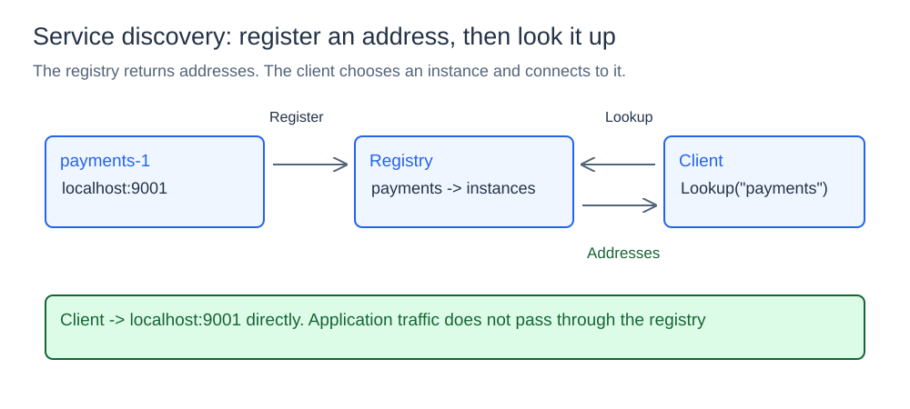
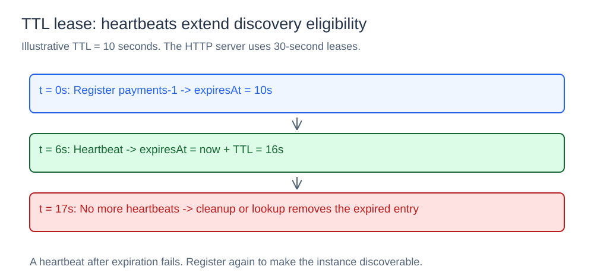

# Service Discovery

## What it is

Services can move between machines and ports. A service registry lets clients look up current instance addresses by a stable service name instead of hardcoding one address.

## How it works

### Registration and lookup



The registry stores `service name -> instance ID -> registration`. Each registration contains an address and expiration time. `Register` creates or replaces the entry for that service and instance ID, with `expiresAt = now + TTL`. Multiple instances can share a service name.

`Lookup(service)` removes expired registrations, then returns the remaining instances for that service. Results come from a map, so their order is unspecified. The client chooses an address and connects directly: the registry does not proxy application traffic or load-balance the returned list.

### Heartbeats and expiration



`Heartbeat(service, id, TTL)` renews a known, unexpired entry by setting a new expiration relative to the current time. A missing or expired entry returns `false`; it must register again.

`StartCleanup(ctx, interval)` scans all registrations periodically until the context is canceled. Lookup also runs expiration cleanup, so stale addresses are filtered even between background scans. `Deregister` removes an instance explicitly and removes its service map if empty.

TTL represents recent contact with the registry, rather than an active health check of the application endpoint. An instance can fail immediately after a heartbeat or lookup, so a returned address can still be unreachable.

### HTTP API

The command listens on `:8080`, uses 30-second registration and heartbeat leases, and runs cleanup every 100 ms. It also seeds a `payments-1` registration at `localhost:9001`.

| Request | Effect |
| --- | --- |
| `POST /register?service=...&id=...&address=...` | Register or replace an instance |
| `GET /lookup?service=...` | Return current instances |
| `GET /heartbeat?service=...&id=...` | Renew an unexpired registration |
| `DELETE /deregister?service=...&id=...` | Remove an instance |

The HTTP layer validates required query parameters and delegates to the registry package. Heartbeat returns `404` for a missing or expired instance; deregister returns `404` for a missing instance.

## Concurrency, cost, and limits

One mutex protects membership and expiration state. Lookup takes the write lock because it performs cleanup before reading. Register, heartbeat, and deregister are O(1) on average; cleanup and lookup scan all registrations for expiration, so that work grows with the total instance count.

State is local and in memory. Restart loses registrations, and multiple registry servers do not share state or run consensus. The registry package is independent of HTTP.

## Project structure

```text
registry/       instance state, leases, heartbeats, and cleanup
cmd/demo/       in-process registration demonstration
cmd/server/     HTTP registry server
diagrams/       SVG illustrations
go.mod
```

## Run it

Run from the `10-service-discovery` directory:

```powershell
go run .\cmd\server\main.go
```

Register an instance:

```powershell
Invoke-RestMethod -Method Post -Uri "http://localhost:8080/register?service=payments&id=payments-2&address=localhost:9002"
```

Look it up:

```powershell
Invoke-RestMethod "http://localhost:8080/lookup?service=payments"
```

Renew its lease:

```powershell
Invoke-RestMethod "http://localhost:8080/heartbeat?service=payments&id=payments-2"
```

Deregister it:

```powershell
Invoke-RestMethod -Method Delete -Uri "http://localhost:8080/deregister?service=payments&id=payments-2"
```
