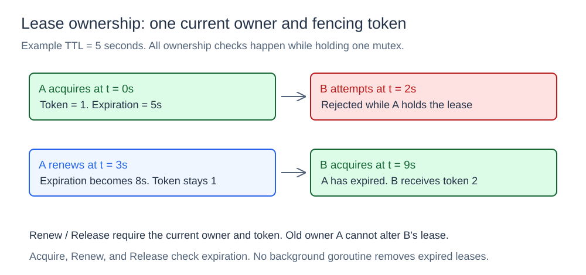
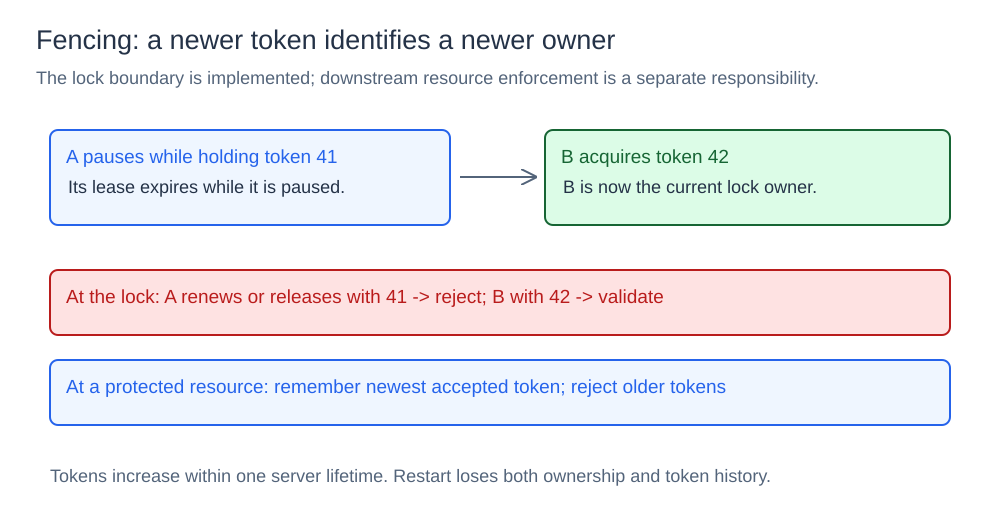

# Distributed Lock

## What it is

A lock service coordinates client access to a shared operation. This component provides one lock with a lease. The lease expires if its owner stops renewal.

## How it works

### Acquire, renew, and release



The lock stores the current owner, token, expiration time, and held state. It also stores the next token counter. `Acquire(owner, TTL)` removes expired ownership first. TTL means time to live. If the lock is free, the function increases the token counter and grants a lease.

If the lock is held, acquire rejects the request. The current owner must use renewal instead of a second acquisition. `Renew(owner, token, TTL)` sets expiration to `now + TTL` without a token change. `Release(owner, token)` removes current ownership.

Renew and release require the current owner and token. They reject an expired lease or an incorrect owner/token pair. All operations check expiration under one mutex. No background expiration goroutine is necessary. Two concurrent acquisitions cannot both succeed in the same lock instance.

### Fencing tokens



Client A can pause with token 41 until its lease expires. Client B can then acquire token 42. If A resumes, its owner/token pair cannot renew or release B's lock.

The shared resource needs its own fencing check. It must keep the newest accepted token and reject older tokens. This prevents an earlier owner from changing the resource after a new owner takes control. This repository checks tokens at the lock service only. It does not implement that separate resource check.

### HTTP service

One server process holds one `Lock` instance. Concurrent HTTP handlers use the same ownership state. The examples use these requests:

| Endpoint | Parameters | Response fields |
| --- | --- | --- |
| `POST /acquire` | `owner`, positive `ttl_ms` | `acquired`, `token` |
| `POST /renew` | `owner`, `token`, positive `ttl_ms` | `renewed` |
| `POST /release` | `owner`, `token` | `released` |

## Concurrency and limits

Each ownership operation takes O(1) time under a `sync.Mutex`. Expiration permits a new owner. It does not stop the previous owner's process.

The token counter increases within one server lifetime. A restart loses ownership and token history. Separate server processes do not coordinate their locks. The service does not replicate state or use consensus to establish ownership.

## Project structure

```text
lock/lock.go        lease and fencing-token mechanism
cmd/demo/main.go    in-process demonstration
cmd/server/main.go  HTTP lock service
diagrams/           SVG illustrations
go.mod
```

## Run it

Open a terminal in the `11-distributed-lock` directory.
Start the in-process demonstration:

```bash
go run ./cmd/demo
```

Run the HTTP service:

```bash
go run ./cmd/server -addr :8080
```

Use another port if `8080` is already in use:

```bash
go run ./cmd/server -addr :8090
```

Run the following acquisition, renewal, and release commands in order:

```powershell
$lock = Invoke-RestMethod -Method Post `
  -Uri "http://localhost:8090/acquire?owner=client-a&ttl_ms=5000"

Invoke-RestMethod -Method Post `
  -Uri "http://localhost:8090/renew?owner=client-a&token=$($lock.token)&ttl_ms=5000"

Invoke-RestMethod -Method Post `
  -Uri "http://localhost:8090/release?owner=client-a&token=$($lock.token)"
```

The commands use one server instance. The server does not replicate ownership state or coordinate with other lock servers.
