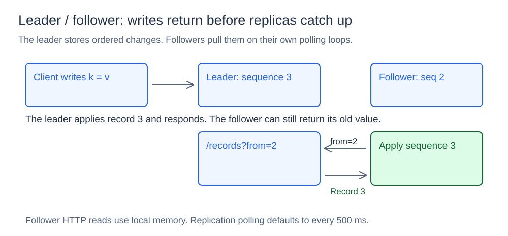
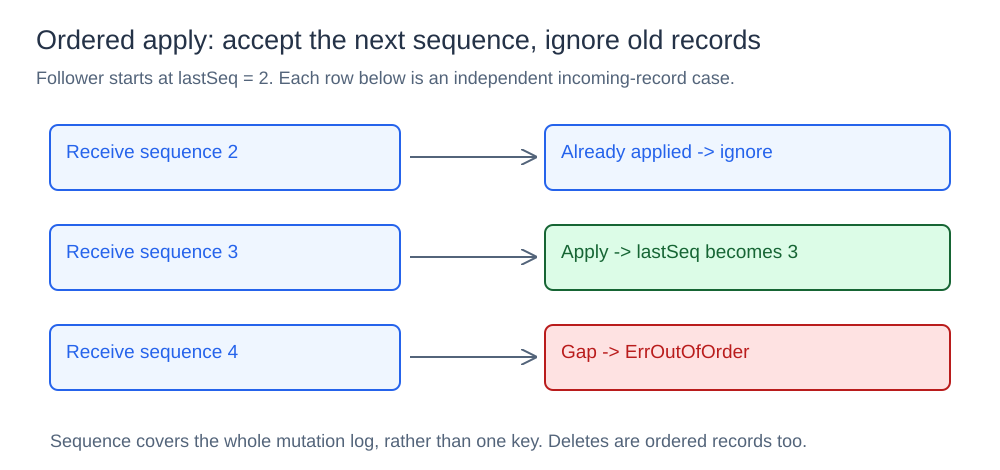
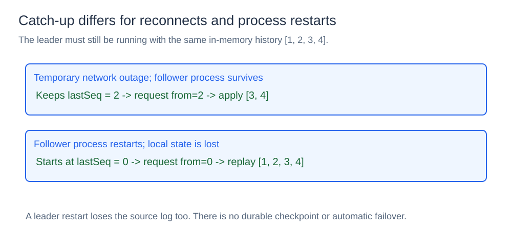

# Replicated Key-Value Store

## What it is

This component keeps a leader's key-value state copied into follower processes. The leader accepts writes, while followers pull ordered mutation records and serve reads from their local maps.

## How it works

### Asynchronous leader / follower replication



Every leader `Put` or `Delete` allocates `lastSeq + 1`, applies the mutation to its map, and appends a record to its in-memory log. A record contains `sequence`, `key`, `value`, and a `deleted` flag. The sequence is the mutation's position in the whole log, rather than a per-key version.

The leader responds after its own update. It does not wait for followers, so a follower may temporarily return an older value or a miss. This keeps the write path simple but exposes replication lag and can lose writes if the leader disappears before followers copy them.

Each follower polls `GET /records?from=N`, where N is its last applied sequence. It applies returned records in order and serves reads from its own map. The default interval is 500 ms, and the HTTP client timeout is two seconds. A failed poll is logged and retried on a later loop; it does not erase the follower's existing state.

### Sequence validation



`Apply(record)` ignores a sequence at or below `lastSeq`, accepts exactly `lastSeq + 1`, and returns `ErrOutOfOrder` for a gap. A put replaces the value; a delete removes the key. This makes repeated records harmless in the intended single-leader history, but does not check whether a duplicate sequence carries conflicting content.

The leader retains records for catch-up through `RecordsAfter`. Followers advance their map and sequence without appending another copy of the replication log; they do not serve as downstream replication leaders.

### Reconnect and restart catch-up



A running follower that loses connectivity keeps its last applied sequence. If it stopped at 2 and the leader advances to 4, reconnection requests records after 2 and applies 3 and 4.

A restarted follower loses its map and sequence. It starts at zero and replays the leader's retained history. Neither role persists state: restarting the leader loses the source log too. There is no epoch or snapshot protocol for reconciling an existing follower with a restarted leader's new history.

## Concurrency and limits

A `sync.RWMutex` protects each store. Leader writes and follower apply operations take the write lock; map reads, sequence reads, and record copies take the read lock. The polling goroutine can run alongside follower HTTP readers.

Map access is O(1) on average. Catch-up copies and transmits the requested suffix of an unbounded in-memory log. There is no durable storage, quorum acknowledgement, automatic promotion, or leader election. If the leader stops, followers can still serve their last known state, but new writes are unavailable.

## Project structure

```text
store/store.go        state, ordered records, and apply logic
cmd/leader/main.go    write API and source replication log
cmd/follower/main.go  polling replica and local read API
diagrams/             SVG illustrations
go.mod
```

## Run it

Run from the `12-replicated-kv-store` directory. Start the leader:

```bash
go run ./cmd/leader -addr :9100
```

Start a follower in another terminal:

```bash
go run ./cmd/follower -addr :9101 -leader http://localhost:9100
```

Write to the leader:

```powershell
Invoke-RestMethod -Method Put `
  -Uri "http://localhost:9100/put?key=language&value=Go"
```

Read from the follower:

```powershell
Invoke-RestMethod `
  -Uri "http://localhost:9101/get?key=language"
```

## Try follower catch-up

This experiment shows what happens when a follower is temporarily unavailable.

First, stop the follower with `Ctrl+C`. Keep the leader running. Then write a new key:

```powershell
Invoke-RestMethod -Method Put `
  -Uri "http://localhost:9100/put?key=database&value=systems"
```

The leader returns `sequence=2`, but the stopped follower has not seen it yet. Start the follower again:

```powershell
go run ./cmd/follower -addr :9101 -leader http://localhost:9100
```

After a successful polling attempt, read from the follower:

```powershell
Invoke-RestMethod `
  -Uri "http://localhost:9101/get?key=database"
```

The follower should return:

```text
found sequence value
True  2        systems
```

Restarting the follower lost its previous map and sequence. It requested records after zero, replayed records 1 and 2 from the still-running leader, and rebuilt its state.

## Useful endpoints

The leader exposes:

- `PUT /put?key=...&value=...` to create or update a key;
- `DELETE /delete?key=...` to append a delete record;
- `GET /get?key=...` to read leader state;
- `GET /records?from=N` to return records after sequence `N`;
- `GET /status` to show the leader's latest sequence.

The follower exposes:

- `GET /get?key=...` to read its local copy;
- `GET /status` to show how far replication has progressed.

The implementation keeps state in memory and has one leader. It demonstrates ordered asynchronous replication and reconnect catch-up, not durable storage, automatic failover, or consensus.
