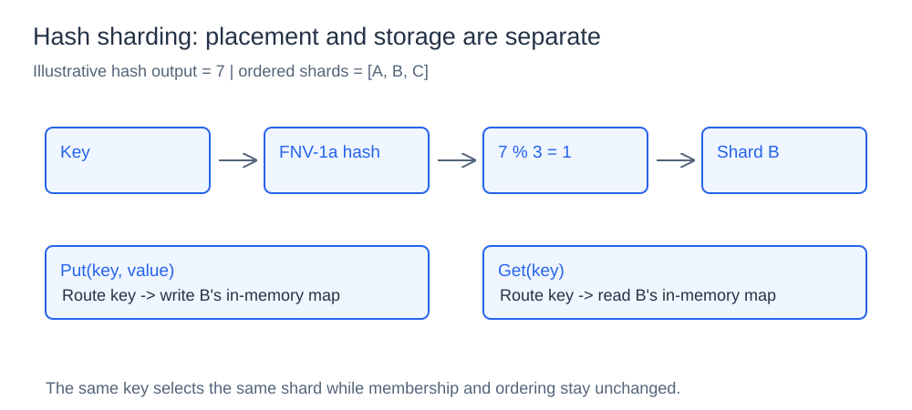
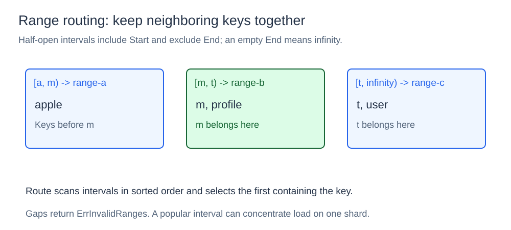
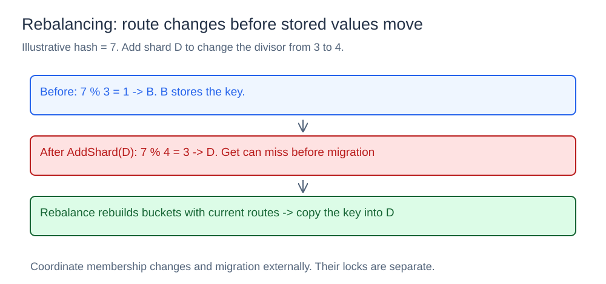

# Sharding Router

## What it is

A sharding router maps each key to one storage partition. The router owns placement metadata; a separate shard map stores the values in per-shard in-memory buckets.

## How it works

### Hash-based routing



`Router` copies an ordered shard list. `Route(key)` computes `FNV-1a(key) % shardCount` and returns the shard at that index. An empty list returns `ErrNoShards`. The same key selects the same owner as long as both membership and ordering stay unchanged.

`ShardMap.Put` routes first, then writes into that shard's map. `Get` repeats the routing decision, reads the selected bucket, and reports both the result and owner. This keeps placement separate from storage.

Hash routing is O(1) for the modulo selection, plus the cost of hashing the key. It spreads keys across a fixed list without grouping them by their values.

### Range-based routing



`RangeRouter` is a separate router with ordered half-open string intervals. Start is inclusive, End is exclusive, and an empty End represents infinity. For `[a, m)`, `[m, t)`, and `[t, infinity)`, apple routes to the first range, profile to the second, and user to the third. A key equal to `m` belongs to the second interval.

Construction copies and sorts ranges. `Route` scans them and selects the first containing the key; an uncovered key returns `ErrInvalidRanges`. Callers should supply non-overlapping intervals, with an unbounded End only on the final range. The demo starts the first range at the empty string so it also covers keys before `a`.

Lookup is O(r) for r ranges. Nearby keys stay together, making ordered partitioning natural, but a popular range can become a hot shard. The current `ShardMap` uses the hash `Router`; the range router is demonstrated separately.

### Membership changes and migration



`AddShard` appends a new shard and rejects a duplicate with `ErrShardExists`. `RemoveShard` removes a known shard or returns `ErrShardNotFound`. Changing the list changes the modulo divisor, so many keys can acquire a new owner.

Membership changes do not move values automatically. `ShardMap.Rebalance` creates fresh buckets for the current shards, re-routes every stored key, copies it into its new bucket, and replaces the bucket map. It returns how many records changed owner. Before migration, a key whose route changed can miss even though its value remains in an old bucket.

Rebalancing is O(k + s) for k stored records and s shards, aside from hashing and allocation. It needs temporary space for rebuilt buckets and blocks shard-map readers and writers while copying.

## Concurrency and limits

The router uses `sync.RWMutex` for its shard list. The shard map has its own mutex for values. These locks protect their individual structures, but a route and subsequent storage operation do not hold a shared membership snapshot. Coordinate membership changes and migration externally if traffic is concurrent.

The implementation stores everything in one process and provides no networking, replication, persistent storage, or online migration protocol. Consistent hashing, implemented in component 4, is a different placement strategy that reduces remapping when membership changes.

## Project structure

```text
shard/router.go   deterministic hash routing and membership
shard/range.go    interval-based routing
shard/map.go      per-shard maps and rebalancing
cmd/demo/main.go  routing and migration demonstration
diagrams/         SVG illustrations
go.mod
```

## Run it

Run from the `13-sharding-router` directory:

```powershell
go run ./cmd/demo
```

The demo stores eight keys, prints routes, adds shard-d, rebalances stored records, and reads user-1 to show the value survived. It then removes shard-d and rebalances again. Output distinguishes `routes_moved` from `records_rebalanced`. A separate example routes apple, profile, user, and zebra through string ranges.
