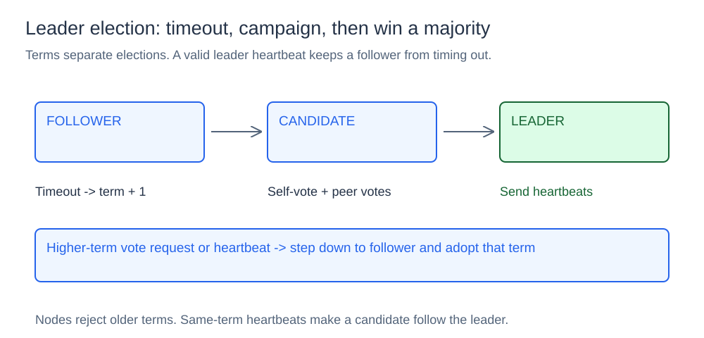
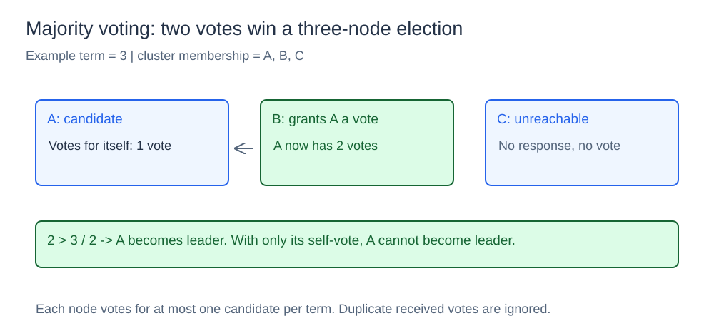
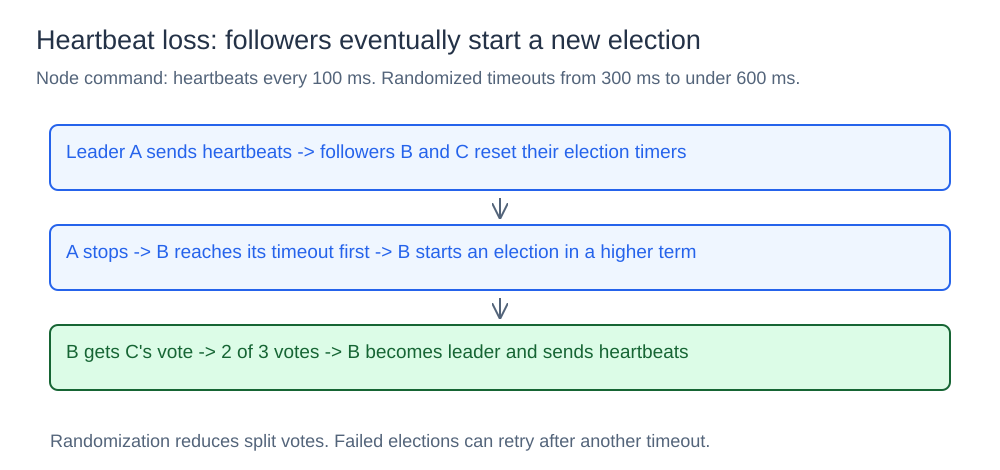

# Leader Election

## What it is

Leader election selects a coordinator from a fixed group of nodes. This component has a voting state machine and an HTTP node process. The processes exchange vote requests and heartbeats.

## How it works

### Follower, candidate, and leader states



`NewNode(id)` starts as a follower. `StartElection` increases its term and removes its known leader. It becomes a candidate and records its own vote. The command requests peer votes for that term.

Each node stores its ID, role, term, chosen candidate, and current leader. It also stores received voter IDs and a buffered timer-reset channel. A mutex protects this state.

### Terms and majority voting



`HandleVoteRequest` rejects an older term. A higher term makes the receiver a follower and removes its previous vote. In one term, the node can grant repeated requests for the same candidate. It cannot vote for another candidate in that term.

`ReceiveVote` ignores duplicate voters. It also ignores votes that do not match the current candidacy and term. `BecomeLeader(clusterSize)` requires more than half the cluster's votes, including the self-vote. Two votes suffice for a three-node group. An isolated candidate cannot win with only its own vote.

The command calculates cluster size from its peer list. Membership is fixed. The state machine assumes valid identities and peer configuration.

### Heartbeats, timeouts, and failover



The command selects a random timeout from 300 ms to less than 600 ms. An accepted heartbeat resets the follower's timer. The leader's heartbeat loop ticks every 100 ms. Random timeouts reduce simultaneous candidacies. Another timeout can start a new attempt after an unsuccessful election.

The node rejects older-term heartbeats. A higher-term heartbeat changes the term and removes the previous vote. An accepted heartbeat makes the receiver a follower and records the leader. This also applies to a candidate that receives a heartbeat in its current term.

The command also returns to follower state after higher-term vote or heartbeat responses. If the leader stops, followers can elect a replacement in a higher term. They still need a majority. The leader sends heartbeats sequentially with a 500 ms HTTP client timeout. An unavailable peer can delay that loop.

## HTTP messages

| Request | Purpose |
| --- | --- |
| `POST /vote` | Request a vote with the candidate term and ID |
| `POST /heartbeat` | Send the leader term and ID |
| `GET /status` | Read the node ID, role, term, leader, and vote count |

## Concurrency and limits

HTTP handlers and timer goroutines share the node mutex. The command runs one local election attempt at a time. It sends peer vote requests concurrently. Each election contacts O(p) peers for p configured peers.

The component uses rules from Raft leader election. It does not provide complete Raft consensus or replicate an application log. Terms, votes, and membership do not survive a restart. Leadership alone does not provide quorum-backed writes or application fencing.

## Project structure

```text
election/node.go    state machine, voting rules, and timers
cmd/demo/main.go    in-process heartbeat / timeout demo
cmd/node/main.go    networked HTTP node
diagrams/           SVG illustrations
go.mod
```

## Run the in-process demo

Open a terminal in the `14-leader-election` directory.
Run this command:

```powershell
go run ./cmd/demo
```

The demonstration sends heartbeats for 500 ms. It then stops heartbeats. A timeout starts an election.

## Run a three-node cluster

Open three terminals in this component directory.
Run one command in each terminal:

```powershell
go run ./cmd/node -id node-a -addr :9201 -peers localhost:9202,localhost:9203
```

```powershell
go run ./cmd/node -id node-b -addr :9202 -peers localhost:9201,localhost:9203
```

```powershell
go run ./cmd/node -id node-c -addr :9203 -peers localhost:9201,localhost:9202
```

Inspect the nodes:

```powershell
Invoke-RestMethod http://localhost:9201/status
Invoke-RestMethod http://localhost:9202/status
Invoke-RestMethod http://localhost:9203/status
```

After a successful election, one node reports leader. The other nodes report follower with the same leader and term.

Stop the current leader with `Ctrl+C`.
Wait for a replacement election.
Read the remaining status endpoints again.

The replacement leader has a higher term and a majority of votes.
