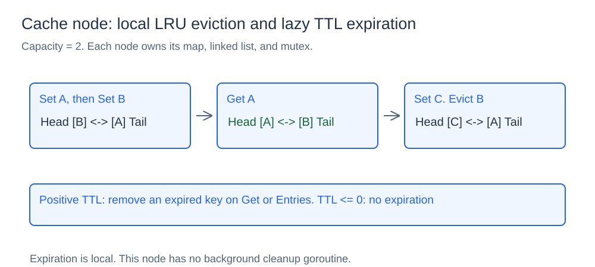
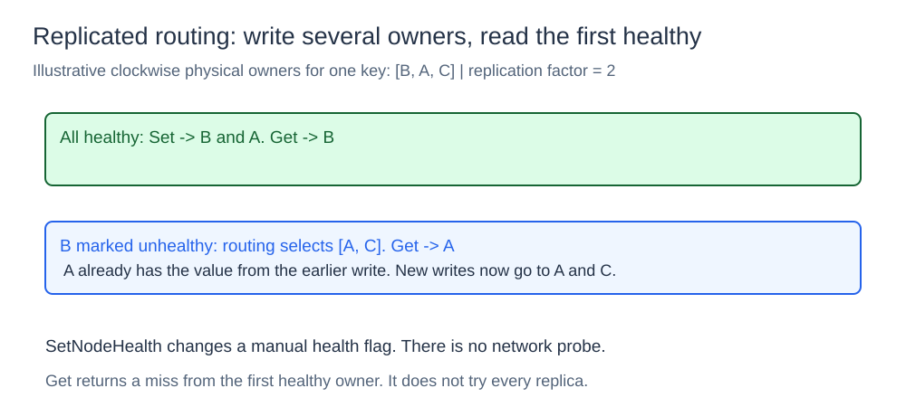
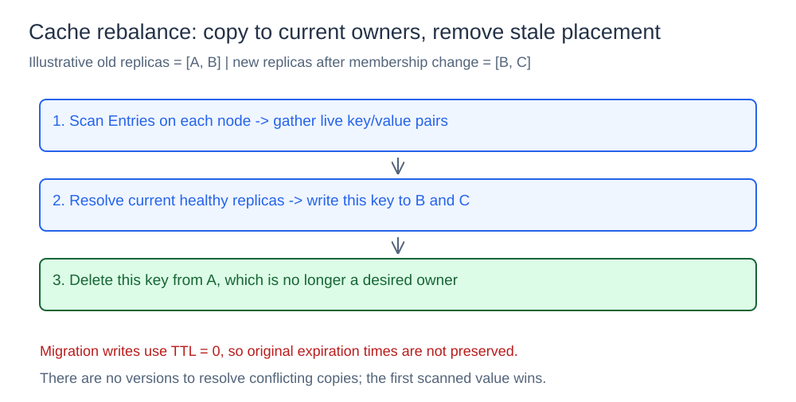

# Distributed Cache

## What it is

This component composes local LRU caches with consistent-hash placement, replication, health-aware routing, and migration. Named nodes are in-memory objects inside one process, rather than independent network servers.

## How it works

### Local cache nodes



Each `Node` has a key-to-entry map and a custom doubly linked list. The head is most recently used and the tail least recently used. `Set` inserts or updates an entry at the head and evicts the tail if capacity is exceeded. `Get` removes an expired entry or promotes a live one. `Delete` removes an entry from both structures.

A positive TTL sets an expiration time; zero or a negative TTL means no expiration. `Entries` scans the node, removes expired entries, and returns a key/value snapshot. `Len` can include expired entries until a read or scan removes them. There is no background expiration loop.

### Placement, replicas, and health



`NewCluster(names, capacity, replicas, replicationFactor)` creates named nodes and a sorted FNV-1a hash ring. Here `replicas` means virtual ring points per node, while `replicationFactor` means the number of physical nodes selected to hold a value. Both counts and capacity must be positive.

Routing hashes the key, binary-searches the first ring point at or after its hash, then walks clockwise and wraps as needed. It collects distinct healthy owners up to the requested replication factor. Repeated virtual points for one physical owner do not create extra copies. If too few nodes are healthy, routing returns the available subset; if none are healthy, it returns `ErrNoNodes`.

`Set` writes sequentially to every selected owner and returns the first owner's name. `Get` reads only the first selected healthy owner. It does not try remaining replicas after a cache miss, even if one of them still has the value.

`SetNodeHealth` changes a manual flag. It is not an active health probe. When the primary is marked unhealthy, routing skips it; a previously written replica may now serve the read. New writes use the current healthy set. A recovered node can contain stale values because there is no version reconciliation or read repair.

### Membership changes and rebalancing



`AddNode` adds an empty node and rebuilds the ring; it does not automatically migrate existing values. Routes can change immediately, so callers can see misses before rebalancing.

`Rebalance` scans nodes in name order, gathers live values, computes their current healthy owners, writes the primary and replicas, then deletes copies on undesired nodes. If replicas disagree, the first scanned value wins; there are no versions to decide which copy is newer. Its moved count compares the first scanned source name with the new primary, rather than counting every replica copy.

`RemoveNode` snapshots that node's live entries, removes membership and rebuilds the ring, then writes those entries to the remaining selected owners while holding the membership write lock. It rejects removing the last node. This is a local migration operation and does not simulate recovering data from an unreachable remote server.

Migration calls `Set` with TTL zero. Original expiration times are not preserved, so moved values become non-expiring. Capacity eviction can also remove values while migration copies entries. These are simplifications of the current implementation.

## Concurrency, cost, and limits

The cluster's `sync.RWMutex` protects membership, health flags, and ring metadata. Each node has its own mutex for the map and recency list. `Set` and `Get` release the membership read lock after choosing node pointers and before accessing values; they do not provide an atomic operation across membership changes.

Rebalance holds a membership read lock, but cache writes can still run concurrently. Its scans and copies are not a transactional snapshot, so migration should be coordinated with writes when preserving the latest value matters.

Local lookup and eviction are O(1) on average. Routing starts with O(log p) binary search for p ring points, then may walk the ring to find healthy distinct owners. Rebalancing scans entries and writes selected copies, so cost grows with stored data and replication factor.

All values disappear on process restart. There is no network transport, durable storage, consensus, quorum protocol, automatic health detection, or conflict resolution in this component.

## Project structure

```text
cache/node.go     local LRU list, TTL, and snapshots
cache/cluster.go  hash ring, replicas, health, and migration
cmd/demo/main.go  local-node and multi-node demonstrations
diagrams/         SVG illustrations
go.mod
```

## Run it

Run from the `15-distributed-cache` directory:

```powershell
go run ./cmd/demo
```

The demo shows local eviction and TTL, creates three nodes with 20 virtual points each and replication factor two, writes and reads user-1, marks its primary unhealthy, then adds cache-d and rebalances. It finally removes cache-d and reads the key again. Output reports selected owners, changed routes, and migrated records.
